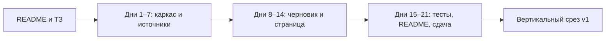

# Mention Desk

Это старт реализации. Страницы, сбора и черновиков в репозитории ещё нет. Их собирают по одному дню: каждый файл в `docs/prompts/` — задание агенту на английском, день заканчивается рабочим состоянием репозитория.

Готовая программа — одна страница в браузере. Сверху название Mention Desk и кнопка «Собрать». Ниже таблица карточек: текст, дата, ссылка, источник, статус. Пока карточек нет, на странице написано «Пока нет упоминаний». Это нормальная пустота.

Кнопка «Собрать» без своего канала и адреса страницы ничего не добавляет и пишет «Укажите канал и адрес страницы». После настройки в таблице появляются карточки со статусом «новое». Повтор того же поста вторую карточку не создаёт.

У карточки есть «Черновик» и «Одобрить». Черновик — короткий ответ рядом с исходным текстом, статус становится «черновик». «Одобрить» ставит «одобрено». Одобренный черновик остаётся на странице. Кнопки «Отправить» нет: сообщение никуда не уходит.

Если облачная модель не подключена, черновик всё равно появляется, над ним пометка «учебный черновик». Если источник не ответил, уже собранные карточки остаются, над таблицей строка «Источник сейчас недоступен».

В первой версии программа читает свой Telegram-канал и одну простую веб-страницу. Запись в Telegram, письма, обход ограничений, VK и открытие сайта браузером задуманы отдельно и в эту версию не входят. Сессия Telegram и ключи остаются только на компьютере пользователя.

Команды запуска и тестов появятся вместе с кодом. До дня 1 сервер поднять нельзя: приложения ещё нет.

## Как идти по дням

Открыть эту папку в агенте и отдать ему один файл дня целиком, начиная с `docs/prompts/day-01-skeleton.md`. Следующий день — только после того, как выполнен блок Done when текущего. Дни не перескакивать: следующие тесты опираются на контракт предыдущих.

Контрольные точки: день 7 — оба источника и отказ от дубля в тестах без сети; день 14 — ручной сценарий шагов 1–5; день 17 — секреты не попадают в git; день 21 — сдача вертикального среза.

Полная картина для пользователя и контракт карточки — в `docs/mention-desk-tz.md`.

## Сценарий проверки старта

1. Открыть `docs/mention-desk-tz.md` и сверить пустую таблицу, «Собрать», «Черновик» и «Одобрить».
2. Отдать агенту `docs/prompts/day-01-skeleton.md`.
3. Убедиться, что работа идёт в корне этой папки, вложенный каталог `mention-desk/` не появился, а день 2 ещё не начат.

---

# Техническое приложение

Кода приложения нет. Ниже — карта старта и правило, по которому написаны дневные промпты. Контракт карточки, `collect`, `draft` и `set_status` остаётся в `docs/mention-desk-tz.md`.

## Файлы

| Путь | Зачем |
| --- | --- |
| `README.md` | Как начать реализацию, пока сервера ещё нет |
| `docs/mention-desk-tz.md` | Картина для пользователя и контракт первой версии |
| `docs/prompts/day-01-skeleton.md` … `day-21-handoff.md` | Одно задание агенту на день, на английском |
| `.gitignore` | `.env`, сессия Telethon, SQLite, кэш Python |

Промпт в ТЗ, который собирает всю первую версию одним заходом, этими файлами заменён: агент выполняет один день.

## Методы и параметры

У дневного промпта фиксированный каркас: прочитать ТЗ, делать только этот день, не создавать вложенную папку `mention-desk/`, не менять `docs/prompts/`, закончить по Done when.

Стек, когда до него дойдёт день 1: Python 3.12, FastAPI, uvicorn, httpx, BeautifulSoup, Telethon, SQLite, pytest. Docker, PostgreSQL, VK и Playwright не ставить.

Настройки, когда появится `.env.example`: `TELEGRAM_API_ID`, `TELEGRAM_API_HASH`, `TELEGRAM_CHANNEL`, `WEB_URL`, `LLM_MODE` (`mock` по умолчанию). Файл сессии: `mention_desk.session`, только локально.

Статусы в базе: `new`, затем `draft`, затем `approved`. На странице: «новое», «черновик», «одобрено».

| День | Файл | Рабочее состояние |
| --- | --- | --- |
| 1 | `day-01-skeleton.md` | Процесс поднимается и отдаёт заглушку |
| 2 | `day-02-card-store.md` | Карточка и SQLite, смена статуса на временной базе |
| 3 | `day-03-normalize-dedup.md` | Нормализация и отказ от дубля |
| 4 | `day-04-web-source.md` | Разбор сохранённого HTML в карточку |
| 5 | `day-05-web-tests.md` | Тесты web без сети |
| 6 | `day-06-telegram-source.md` | Интерфейс чтения своего канала, клиент снаружи |
| 7 | `day-07-telegram-tests.md` | Фикстура Telegram и общий дедуп |
| 8 | `day-08-draft-mock.md` | Учебный черновик без сети |
| 9 | `day-09-draft-real.md` | Один облачный запрос и откат на mock |
| 10 | `day-10-draft-status.md` | Черновик пишется в базу, статус `draft` |
| 11 | `day-11-page-empty.md` | Страница и пустая таблица |
| 12 | `day-12-collect-button.md` | «Собрать» и проверка настроек |
| 13 | `day-13-source-errors-approve.md` | Баннер источника и «Одобрить» |
| 14 | `day-14-buffer-review.md` | Ручной сценарий 1–5 и мелкий UX |
| 15 | `day-15-status-boundary-tests.md` | Запреты переходов и сбой источника |
| 16 | `day-16-offline-scenario-test.md` | Сквозной тест без сети |
| 17 | `day-17-secrets-hygiene.md` | В git нет секретов |
| 18 | `day-18-readme.md` | README, по которому проект поднимает другой человек |
| 19 | `day-19-manual-checklist.md` | Прогон на живом канале, список расхождений |
| 20 | `day-20-polish.md` | Правки по прогону, шаги 1–5 без обходов |
| 21 | `day-21-handoff.md` | Тесты, README, демо, контракт |

## Примеры кода

Прикладного кода в репозитории нет. Образец подмены HTTP, на который должен опираться день 5, приведён в ТЗ и относится к Career Agent:

```83:89:docs/mention-desk-tz.md
    transport = httpx.MockTransport(handler)
    async with httpx.AsyncClient(transport=transport) as client:
        cards = await fetch_hh_vacancies(client, "python")
    assert seen[0].method == "GET"
    assert cards[0]["url"] == "https://hh.ru/vacancy/9"
    assert "highlighttext" not in cards[0]["title"]
    assert cards[0]["company_name"] == "АНТ"
```

Поля карточки, с которыми сверяются дни 2–7:

```63:70:docs/mention-desk-tz.md
| Поле | Смысл |
| --- | --- |
| `source` | `telegram` или `web` |
| `external_id` | id поста или канонический URL |
| `text` | текст без лишних пробелов |
| `url` | ссылка на пост или страницу |
| `published_at` | дата в ISO 8601 либо пусто |
| `status` | `new`, затем `draft`, затем `approved` |
```

## Блок-схема


