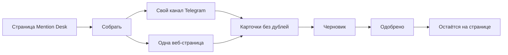

# Mention Desk — техническое задание

Отдельная программа, не часть Career Agent и не часть Outreach AI Cortex. Она собирает упоминания из своего Telegram-канала и с одной простой веб-страницы, показывает их карточками и готовит черновик ответа. Сообщение наружу не уходит.

Первая версия для портфолио под вакансию про сбор данных и мини-CRM. VK, обход сайтов браузером и рассылки задуманы, ещё нет.

## Что видит пользователь

Пользователь открывает одну страницу в браузере. Сверху название Mention Desk и кнопка «Собрать». Ниже таблица карточек. У карточки есть текст, дата, ссылка, источник и статус.

Пока источников нет, таблица пустая. Пустая таблица — нормальное состояние, не сбой. Надпись на странице: «Пока нет упоминаний». Кнопка «Собрать» без настроенных канала и адреса страницы ничего не добавляет и пишет: «Укажите канал и адрес страницы».

После настройки пользователь нажимает «Собрать». В таблице появляются новые карточки со статусом «новое». Повторный сбор того же поста не создаёт вторую карточку.

Пользователь открывает карточку. Рядом с исходным текстом кнопка «Черновик». После нажатия появляется короткий ответ и статус меняется на «черновик». Кнопка «Одобрить» ставит статус «одобрено». Кнопки «Отправить» нет. Одобренный черновик остаётся на странице.

Если облачная модель не подключена, черновик всё равно появляется. Над ним пометка «учебный черновик»: текст заранее заготовлен и не ходит в сеть. Это не ошибка.

Если источник не ответил, уже собранные карточки остаются на месте. Над таблицей строка «Источник сейчас недоступен».

## Чего программа не делает

Не пишет в Telegram, не шлёт письма и не публикует ответы. Не обходит ограничения площадок, не подбирает прокси и не входит в чужие аккаунты. Не забирает VK и не открывает сайт браузером. Эти источники можно добавить позже тем же видом карточки.

Сессия Telegram и ключи остаются только у пользователя на компьютере. В материалы проекта они не попадают.

## Сценарий проверки

1. Открыть страницу без настроек. Видна пустая таблица и текст «Пока нет упоминаний».
2. Нажать «Собрать». Карточки не появляются, видна просьба указать канал и адрес страницы.
3. Указать свой тестовый канал и адрес простой страницы, снова нажать «Собрать». В таблице есть карточки со статусом «новое».
4. Нажать «Собрать» ещё раз. Число карточек не выросло.
5. Открыть карточку, нажать «Черновик», сверить ответ с текстом поста. Нажать «Одобрить». Статус «одобрено», сообщение никуда не ушло.
6. Прогнать проверки без сети. Они читают заранее сохранённые пост и кусок страницы и проверяют поля карточки и отсутствие дубля.

---

# Техническое приложение

Код Mention Desk в этом репозитории не лежит. Ниже контракт первой версии и промпт, которым её можно начать в пустой папке. Образец проверки HTTP без сети уже есть в Career Agent.

## Файлы

| Путь | Зачем |
| --- | --- |
| `mention-desk/README.md` | Как запустить и что программа сознательно не отправляет |
| `mention-desk/.env.example` | Имена настроек без значений |
| `mention-desk/.gitignore` | Сессия Telegram, `.env`, база |
| `mention-desk/requirements.txt` | Зависимости первой версии |
| `mention-desk/app/main.py` | Страница и кнопки, без правил сбора |
| `mention-desk/app/services/collect.py` | Сбор, нормализация, отказ от дубля |
| `mention-desk/app/services/telegram_source.py` | Чтение истории своего канала |
| `mention-desk/app/services/web_source.py` | Чтение одной страницы по HTTP |
| `mention-desk/app/services/drafts.py` | Учебный или облачный черновик |
| `mention-desk/app/store.py` | Карточки и смена статуса в SQLite |
| `mention-desk/tests/fixtures/` | Сохранённые пост и HTML |
| `mention-desk/tests/test_collect.py` | Поля карточки и дедуп без сети |

## Методы и параметры

Общая карточка, которую возвращают оба источника:

| Поле | Смысл |
| --- | --- |
| `source` | `telegram` или `web` |
| `external_id` | id поста или канонический URL |
| `text` | текст без лишних пробелов |
| `url` | ссылка на пост или страницу |
| `published_at` | дата в ISO 8601 либо пусто |
| `status` | `new`, затем `draft`, затем `approved` |

`collect(sources) -> list[Card]`. Читает настроенные источники, приводит записи к карточке, считает ключ `source + external_id`. Повтор с тем же ключом не вставляет вторую строку. Ошибка одного источника не стирает уже сохранённое.

`draft(card, mode) -> str`. При `mode=mock` возвращает фиксированный учебный текст и не открывает сеть. При `mode=real` один запрос к облачной модели: в ответе только пересказ фактов из `card.text`. Нет ключа — остаться на `mock`.

`set_status(card_id, status)`. Разрешены только `new → draft → approved`. Обратного перехода и статуса «отправлено» нет.

Настройки в окружении: `TELEGRAM_API_ID`, `TELEGRAM_API_HASH`, `TELEGRAM_CHANNEL`, `WEB_URL`, `LLM_MODE` (`mock` по умолчанию). Файл сессии Telethon: `mention_desk.session`, только локально.

Стек первой версии: Python 3.12, FastAPI, httpx, BeautifulSoup, Telethon, SQLite, pytest. Docker, PostgreSQL, VK и Playwright не ставить.

## Примеры кода

Это существующие проверки Career Agent, не код Mention Desk. Так же подменять HTTP в тестах сбора: заранее сохранённый ответ, ни одного живого запроса.

```83:89:backend/tests/test_sources.py
    transport = httpx.MockTransport(handler)
    async with httpx.AsyncClient(transport=transport) as client:
        cards = await fetch_hh_vacancies(client, "python")
    assert seen[0].method == "GET"
    assert cards[0]["url"] == "https://hh.ru/vacancy/9"
    assert "highlighttext" not in cards[0]["title"]
    assert cards[0]["company_name"] == "АНТ"
```

```108:117:backend/tests/test_sources.py
    def handler(request: httpx.Request) -> httpx.Response:
        assert request.method == "GET"
        return httpx.Response(200, text=xml)

    transport = httpx.MockTransport(handler)
    async with httpx.AsyncClient(transport=transport) as client:
        cards = await fetch_remote_ok(client, "python fastapi")
    assert len(cards) == 1
    assert cards[0]["source"] == "remote_ok"
    assert cards[0]["region"] == "intl"
```

## Блок-схема



## Промпт для старта

Вставить в пустую папку `mention-desk` в режиме агента.

```
Собери первую версию Mention Desk по docs/mention-desk-tz.md из репозитория Career Agent. Код лежит в этой пустой папке, не в Career Agent.

Пользователь открывает одну страницу: кнопка «Собрать», таблица карточек (текст, дата, ссылка, источник, статус). Пустая таблица показывает «Пока нет упоминаний». Без канала и адреса страницы «Собрать» ничего не добавляет и пишет «Укажите канал и адрес страницы». Повтор того же поста не создаёт вторую карточку. У карточки есть «Черновик» и «Одобрить». Статусы только new → draft → approved. Кнопки «Отправить» нет, наружу ничего не постится.

Источники v1: история одного своего Telegram-канала через Telethon и одна страница через httpx + BeautifulSoup. VK, Playwright, Selenium, прокси, рассылки и запись в Telegram не делать.

LLM_MODE по умолчанию mock: учебный черновик без сети и с пометкой «учебный черновик». real — один облачный запрос, в черновике только факты из текста карточки. Нет ключа — остаться на mock.

Секреты только в .env. В git: .env.example и .gitignore для .env, *.session и sqlite. Тесты читают fixtures и httpx.MockTransport, сеть не открывают. Проверь поля карточки и дедуп.

Стек: Python 3.12, FastAPI, SQLite, requirements.txt. Без Docker и PostgreSQL. Правила сбора не клади в роутер. В README напиши, как запустить и что программа не отправляет сообщения.

Сделай вертикальный срез, который проходит pytest без сети. Живой Telethon не вызывай из тестов.
```
